# Step 1. Create folder for each Work Sapce

```bash
mkdir fe-network-ws fe-compute-ws fe-security-ws be-network-ws be-compute-ws be-security-ws vpc-peering-fe-be
``` 


# Step 2. Creae Project and Worksapce in Hashicorp as created folder


# Step 3. Write  terrafrom code for vpc, subnetes, igw, route tables, subnetassocation, nat gateway in frontend worksapce

[fe-providers.tf](../terraform/fe-network-ws/providers.tf)
[fe-versions.tf](../terraform/fe-network-ws/versions.tf)
[fe-network.tf](../terraform/fe-network-ws/frontend-network.tf)
[fe-variables.tf](../terraform/fe-network-ws/variables.tf)
[fe-outputs.tf](../terraform/fe-network-ws/outputs.tf)

*Crete Access Key and Secret Access key to access aws API*

**Add AWS_ACCESS_KEY_ID and AWS_SECRET_ACCESS_KEY into variables of fe-network-ws**

```bash
terrafrom login
terraform init
terraform fmt
terraform validate
terraform plan
terraform apply
```
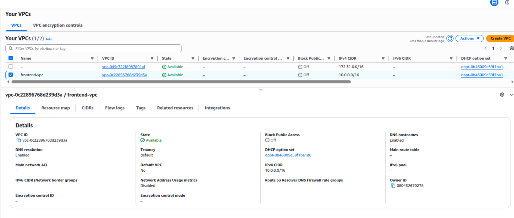
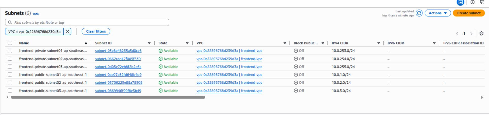
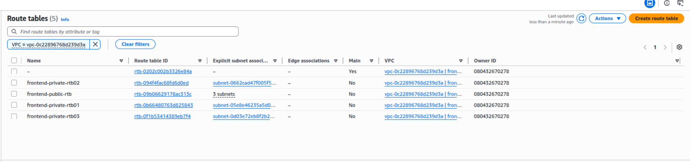
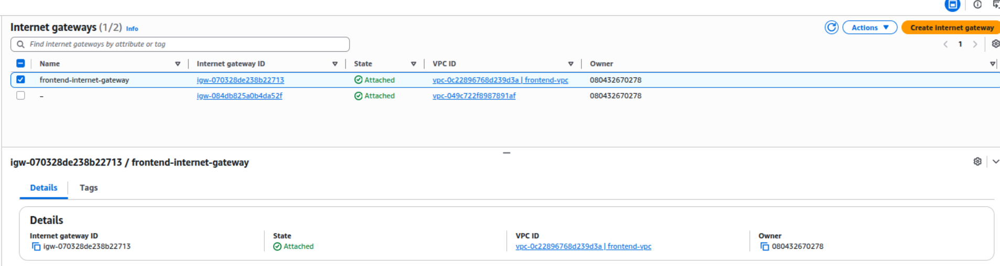
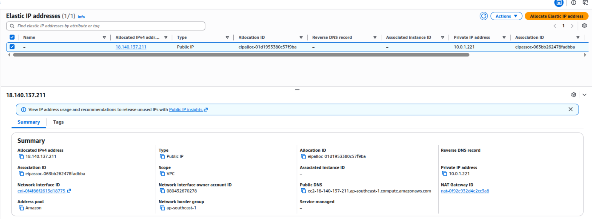
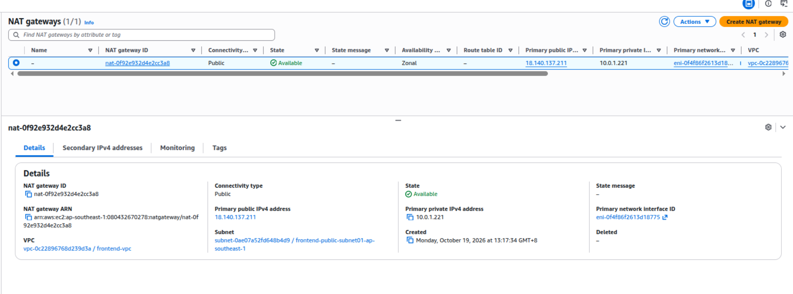


### 3.1 Share the outputs of network workspace to fe-security-ws and fe-compute-ws in Hashicorp terrafrom

Workspaces -> Settings -> General --> Remote state sharing --> Share with specific workspaces


# Step 4. Write  terrafrom code for security group in frontend worksapce

[fe-providers.tf](../terraform/fe-security-ws/providers.tf)
[fe-versions.tf](../terraform/fe-security-ws/versions.tf)
[fe-tfeoutput.tf](../terraform/fe-security-ws/tfeoutput.tf)
[fe-security-groups.tf](../terraform/fe-security-ws/fe-security-groups.tf)
[fe-variables.tf](../terraform/fe-security-ws/variables.tf)

*Crete Access Key and Secret Access key to access aws API*

**Add AWS_ACCESS_KEY_ID and AWS_SECRET_ACCESS_KEY into variables of fe-security-ws**

```bash
terraform init
terraform fmt
terraform validate
terraform plan
terraform apply
```

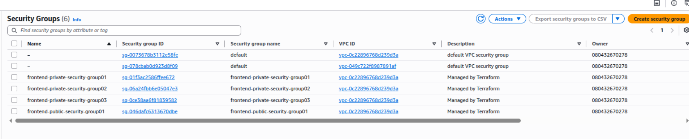

### 3.1 Share the outputs of fe-security workspace to fe-compute-workspace in Hashicorp terrafrom

Workspaces -> Settings -> General --> Remote state sharing --> Share with specific workspaces

# Step 5. Write  terrafrom code for instances in frontend compute worksapce

[fe-versions.tf](../terraform/fe-compute-ws/versions.tf)
[fe-providers.tf](../terraform/fe-compute-ws/providers.tf)
[fe-keypairs.tf](../terraform/fe-compute-ws/keypairs.tf)
[fe-output.tf](../terraform/fe-compute-ws/output.tf)
[fe-tfeoutput.tf](../terraform/fe-compute-ws/tfeoutput.tf)
[fe-private-instances.tf](../terraform/fe-compute-ws/fe-private-instances.tf)
[fe-public-instances.tf](../terraform/fe-compute-ws/fe-public-instances.tf)
[fe-variables.tf](../terraform/fe-compute-ws/variables.tf)

*Crete Access Key and Secret Access key to access aws API*

**Add AWS_ACCESS_KEY_ID and AWS_SECRET_ACCESS_KEY into variables of fe-compute-ws**
```bash
terraform init
terraform fmt
terraform validate
terraform plan
terraform apply
terraform output -raw be_private_key_pem > fe-private-ssh-keypair.pem
chmod 400 fe-private-ssh-keypair.pem
```


# Step 6. Write  terrafrom code for vpc, subnetes, igw, route tables, subnetassocation, nat gateway in backend worksapce

## 1. Create terrafrom code for VPC,Subnetes

[be-provider.tf](../terraform/be-network-ws/providers.tf)
[be-versions.tf](../terraform/be-network-ws/versions.tf)
[be-network.tf](../terraform/be-network-ws/backend-network.tf)
[be-varialbes.tf](../terraform/be-network-ws/variables.tf)
[be-outputs.tf](../terraform/be-network-ws/outputs.tf)

*Crete Access Key and Secret Access key to access aws API*

**Add AWS_ACCESS_KEY_ID and AWS_SECRET_ACCESS_KEY into variables of be-network-ws**

```bash
terraform init
terraform fmt
terraform validate
terraform plan
terraform apply -auto-approve
```
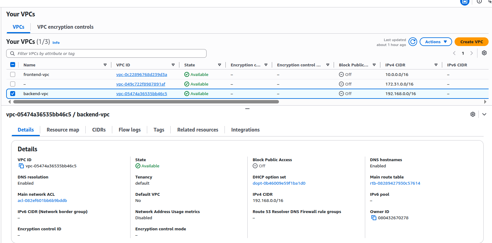
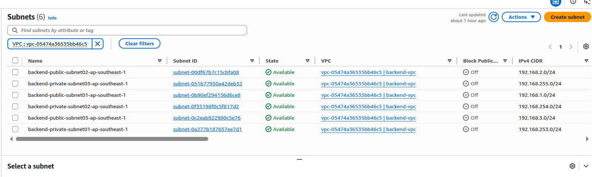
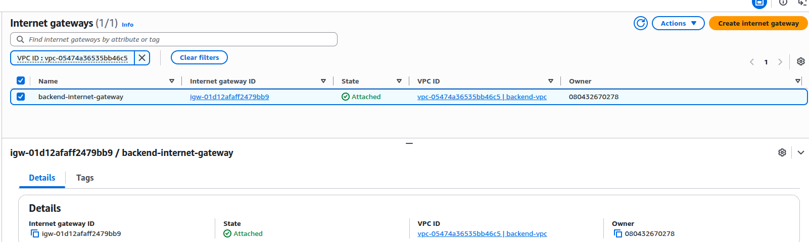
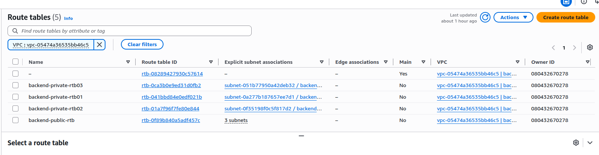


# Step 7. Write  terrafrom code for security groups in backend worksapce

[be-security-groups.tf](../terraform/be-security-ws/be-security-groups.tf)
[be-outputs.tf](../terraform/be-security-ws/outputs.tf)
[be-providers.tf](../terraform/be-security-ws/providers.tf)
[be-variables.tf](../terraform/be-security-ws/variables.tf)
[be-versions.tf](../terraform/be-security-ws/versions.tf)
[be-tfeoutput.tf](../terraform/be-compute-ws/tfeoutput.tf)

*Crete Access Key and Secret Access key to access aws API*
**Add AWS_ACCESS_KEY_ID and AWS_SECRET_ACCESS_KEY into variables of be-security-ws**

```bash
terraform init
terraform fmt
terraform validate
terraform plan
terraform apply -auto-approve
```

# Step 8. Write  terrafrom code for instances in backend worksapce

[be-providers.tf](../terraform/be-compute-ws/providers.tf)
[be-versions.tf](../terraform/be-compute-ws/versions.tf)
[be-keypairs.tf](../terraform/be-compute-ws/keypairs.tf)
[be-tfeoutput.tf](../terraform/be-compute-ws/tfeoutput.tf)
[be-private-instances.tf](../terraform/be-compute-ws/be-private-instances.tf)
[be-public-instances.tf](../terraform/be-compute-ws/be-public-instances.tf)
[be-variables.tf](../terraform/be-compute-ws/variables.tf)
[be-output.tf](../terraform/fe-compute-ws/output.tf)

*Crete Access Key and Secret Access key to access aws API*

**Add AWS_ACCESS_KEY_ID and AWS_SECRET_ACCESS_KEY into variables of be-compute-ws**

```bash
terraform init
terraform fmt
terraform validate
terraform plan
terraform apply -auto-approve
terraform output -raw be_private_key_pem > be-private-ssh-keypair.pem
chmod 400 be-private-ssh-keypair.pem
```
# Step 9. Write  terrafrom code for vpc peering  in backend worksapce

Workspaces -> Settings -> General --> Remote state sharing --> Share with specific workspaces

fe-network-ws ------> vpc-peering-fe-be
be-network-ws ------> vpc-peering-fe-be
fe-security-ws -----> vpc-peering-fe-be
be-security-ws -----> vpc-peering-fe-be

[vpc-peering-providers.tf](../terraform/vpc-peering-fe-be/providers.tf)
[vpc-peering-versions.tf](../terraform/vpc-peering-fe-be/versions.tf)
[vpc-peering-variables.tf](../terraform/vpc-peering-fe-be/variables.tf)
[vpc-peering-tfeoutputs.tf](../terraform/vpc-peering-fe-be/tfeoutput.tf)
[vpc-peering-fe-be.tf](../terraform/vpc-peering-fe-be/fe-be-vpc-peering.tf)


*Crete Access Key and Secret Access key to access aws API*

**Add AWS_ACCESS_KEY_ID and AWS_SECRET_ACCESS_KEY into variables of vpc-peering-fe-be**

```bash
terraform init
terraform fmt
terraform validate
terraform plan
terraform apply -auto-approve
```

[vpc-peering](../evidences/vpc-peering.png)
[vpc-route](../evidences/vpc-routes.png)

# Step 10. Testing (frontend)

*Create SSH Host File!*

```bash
Host hc-frontend-pub-1
    Hostname 54.255.201.196
    User ec2-user
    IdentityFile ~/.ssh/fe-private-ssh-keypair.pem
    IdentitiesOnly yes

Host hc-frontend-prv-1
    Hostname 10.0.253.142
    User ubuntu
    IdentityFile ~/.ssh/fe-private-ssh-keypair.pem
    IdentitiesOnly yes
    ProxyJump hc-frontend-pub-1


Host hc-frontend-prv-2
    Hostname 10.0.254.203
    User ubuntu
    IdentityFile ~/.ssh/fe-private-ssh-keypair.pem
    IdentitiesOnly yes
    ProxyJump hc-frontend-prv-1

Host hc-frontend-prv-3
    Hostname 10.0.255.180
    User ubuntu
    IdentityFile ~/.ssh/fe-private-ssh-keypair.pem
    IdentitiesOnly yes
    ProxyJump hc-frontend-prv-1
```
```bash
cd ~/.ssh
cat config
# add ssh host file into config using vi or nano
```


1. Ping from local pc to public_instance_1(fe)

```bash
min-myat-ko@ubuntu$ping 54.255.201.196
PING 54.255.201.196 (54.255.201.196) 56(84) bytes of data.
64 bytes from 54.255.201.196: icmp_seq=1 ttl=120 time=14.9 ms
64 bytes from 54.255.201.196: icmp_seq=2 ttl=121 time=16.0 ms
64 bytes from 54.255.201.196: icmp_seq=3 ttl=121 time=13.5 ms
64 bytes from 54.255.201.196: icmp_seq=4 ttl=120 time=12.9 ms
64 bytes from 54.255.201.196: icmp_seq=5 ttl=121 time=13.2 ms
```
2. SSH login from pc to public_instance_1(fe) 
```bash
min-myat-ko@ubuntu$ssh hc-frontend-pub-1
** WARNING: connection is not using a post-quantum key exchange algorithm.
** This session may be vulnerable to "store now, decrypt later" attacks.
** The server may need to be upgraded. See https://openssh.com/pq.html
   ,     #_
   ~\_  ####_        Amazon Linux 2023
  ~~  \_#####\
  ~~     \###|
  ~~       \#/ ___   https://aws.amazon.com/linux/amazon-linux-2023
   ~~       V~' '->
    ~~~         /
      ~~._.   _/
         _/ _/
       _/m/'
Last login: Fri Oct 23 17:33:29 2026 from 161.142.142.210
```

3. Ping from public_instance_1(fe) to internet
```bash
[ec2-user@ip-10-0-1-71 ~]$ ping 8.8.8.8
PING 8.8.8.8 (8.8.8.8) 56(84) bytes of data.
64 bytes from 8.8.8.8: icmp_seq=1 ttl=114 time=0.960 ms
64 bytes from 8.8.8.8: icmp_seq=2 ttl=114 time=0.954 ms
64 bytes from 8.8.8.8: icmp_seq=3 ttl=114 time=0.962 ms
64 bytes from 8.8.8.8: icmp_seq=4 ttl=114 time=0.979 ms
64 bytes from 8.8.8.8: icmp_seq=5 ttl=114 time=0.970 ms
```
4. Ping from public_instance_1(fe) to prviate_instance_1(fe)
```bash
[ec2-user@ip-10-0-1-71 ~]$ ping 10.0.253.142
PING 10.0.253.142 (10.0.253.142) 56(84) bytes of data.
64 bytes from 10.0.253.142: icmp_seq=1 ttl=64 time=0.923 ms
64 bytes from 10.0.253.142: icmp_seq=2 ttl=64 time=0.328 ms
64 bytes from 10.0.253.142: icmp_seq=3 ttl=64 time=0.331 ms
64 bytes from 10.0.253.142: icmp_seq=4 ttl=64 time=0.331 ms
```
4.1 Ping from public_instance_1(fe) to prviate_instance_2(fe) & private_instance_3(fe)

*Expected result: Fail coz no security rule allow*
```bash
[ec2-user@ip-10-0-1-71 ~]$ ping 10.0.254.203
PING 10.0.254.203 (10.0.254.203) 56(84) bytes of data.
^C
--- 10.0.254.203 ping statistics ---
99 packets transmitted, 0 received, 100% packet loss, time 101923ms

[ec2-user@ip-10-0-1-71 ~]$ ping 10.0.255.180
PING 10.0.255.180 (10.0.255.180) 56(84) bytes of data.
^C
--- 10.0.255.180 ping statistics ---
4 packets transmitted, 0 received, 100% packet loss, time 3116ms
```
5. SSH from public_instance_1(fe) to private_instance_1

```bash
ssh hc-frontend-prv-1
```

5.1 Ping from prviate_instance_1(fe) to internet

```bash
ubuntu@ip-10-0-253-142:~$ ping 8.8.8.8
PING 8.8.8.8 (8.8.8.8) 56(84) bytes of data.
64 bytes from 8.8.8.8: icmp_seq=1 ttl=113 time=1.73 ms
64 bytes from 8.8.8.8: icmp_seq=2 ttl=113 time=1.17 ms
64 bytes from 8.8.8.8: icmp_seq=3 ttl=113 time=1.16 ms
```

6. Ping from prviate_instance_1(fe) to private_instance_2(fe)

```bash
ubuntu@ip-10-0-253-142:~$ ping 10.0.254.203
PING 10.0.254.203 (10.0.254.203) 56(84) bytes of data.
64 bytes from 10.0.254.203: icmp_seq=1 ttl=64 time=1.11 ms
64 bytes from 10.0.254.203: icmp_seq=2 ttl=64 time=0.897 ms
64 bytes from 10.0.254.203: icmp_seq=3 ttl=64 time=0.907 ms
64 bytes from 10.0.254.203: icmp_seq=4 ttl=64 time=0.890 ms
```
7. SSH login to private_instance_2(fe)
```bash
ssh hc-frontend-prv-2
```
7. Ping from prviate_instance_2(fe) to private_instance_2(be)

```bash
ubuntu@ip-10-0-254-203:~$ ping 192.168.254.177
PING 192.168.254.177 (192.168.254.177) 56(84) bytes of data.
64 bytes from 192.168.254.177: icmp_seq=1 ttl=64 time=0.497 ms
64 bytes from 192.168.254.177: icmp_seq=2 ttl=64 time=0.200 ms
64 bytes from 192.168.254.177: icmp_seq=3 ttl=64 time=0.246 ms
64 bytes from 192.168.254.177: icmp_seq=4 ttl=64 time=0.222 ms
64 bytes from 192.168.254.177: icmp_seq=5 ttl=64 time=0.241 ms
```
8. Ping from prviate_instance_1(fe) to private_instance_3(fe)
```bash
ubuntu@ip-10-0-253-142:~$ ping 10.0.255.180
PING 10.0.255.180 (10.0.255.180) 56(84) bytes of data.
64 bytes from 10.0.255.180: icmp_seq=1 ttl=64 time=0.848 ms
64 bytes from 10.0.255.180: icmp_seq=2 ttl=64 time=0.544 ms
64 bytes from 10.0.255.180: icmp_seq=3 ttl=64 time=0.554 ms
64 bytes from 10.0.255.180: icmp_seq=4 ttl=64 time=0.556 ms
```

9. Ping from prviate_instance_3(fe) to private_instance_3(be)
```bash
ubuntu@ip-10-0-255-180:~$ ping 192.168.255.15
PING 192.168.255.15 (192.168.255.15) 56(84) bytes of data.
64 bytes from 192.168.255.15: icmp_seq=1 ttl=64 time=9.93 ms
64 bytes from 192.168.255.15: icmp_seq=2 ttl=64 time=0.298 ms
64 bytes from 192.168.255.15: icmp_seq=3 ttl=64 time=0.182 ms
64 bytes from 192.168.255.15: icmp_seq=4 ttl=64 time=0.199 ms
64 bytes from 192.168.255.15: icmp_seq=5 ttl=64 time=0.188 ms
```
10. Ping from prviate_instance_3(fe) to private_instance_2(be)

*Expected Result: Fail (no security allow)
```bash
ubuntu@ip-10-0-255-180:~$ ping 192.168.254.177
PING 192.168.254.177 (192.168.254.177) 56(84) bytes of data.
^C
--- 192.168.254.177 ping statistics ---
10 packets transmitted, 0 received, 100% packet loss, time 9251ms
```

# Step 10.1 Testing (backend)

1. Ping from local pc to public_instance_1(be)
```bash
min-myat-ko@ubuntu$ping 52.76.170.12
PING 52.76.170.12 (52.76.170.12) 56(84) bytes of data.
64 bytes from 52.76.170.12: icmp_seq=1 ttl=121 time=13.5 ms
64 bytes from 52.76.170.12: icmp_seq=2 ttl=121 time=12.8 ms
64 bytes from 52.76.170.12: icmp_seq=3 ttl=120 time=11.0 m
```

2. SSH login from pc to public_instance_1(be)
```bash
min-myat-ko@ubuntu$ssh hc-backend-pub-1
** WARNING: connection is not using a post-quantum key exchange algorithm.
** This session may be vulnerable to "store now, decrypt later" attacks.
** The server may need to be upgraded. See https://openssh.com/pq.html
   ,     #_
   ~\_  ####_        Amazon Linux 2023
  ~~  \_#####\
  ~~     \###|
  ~~       \#/ ___   https://aws.amazon.com/linux/amazon-linux-2023
   ~~       V~' '->
    ~~~         /
      ~~._.   _/
         _/ _/
       _/m/'
Last login: Fri Oct 23 16:11:28 2026 from 161.142.142.210
```

3. Ping from public_instance_1(be) to internet
```bash
PING 8.8.8.8 (8.8.8.8) 56(84) bytes of data.
64 bytes from 8.8.8.8: icmp_seq=1 ttl=114 time=0.973 ms
64 bytes from 8.8.8.8: icmp_seq=2 ttl=114 time=0.996 ms
64 bytes from 8.8.8.8: icmp_seq=3 ttl=114 time=0.970 ms
64 bytes from 8.8.8.8: icmp_seq=4 ttl=114 time=0.993 ms
```

4. Ping from public_instance_1(be) to prviate_instance_01(be)
```bash
[ec2-user@ip-192-168-1-111 ~]$ ping 192.168.253.195
PING 192.168.253.195 (192.168.253.195) 56(84) bytes of data.
64 bytes from 192.168.253.195: icmp_seq=1 ttl=64 time=0.185 ms
64 bytes from 192.168.253.195: icmp_seq=2 ttl=64 time=0.156 ms
64 bytes from 192.168.253.195: icmp_seq=3 ttl=64 time=0.164 ms
64 bytes from 192.168.253.195: icmp_seq=4 ttl=64 time=0.198 ms
```
5. Ping from prviate_instance_1(be) to internet
```bash
ubuntu@ip-192-168-253-195:~$ ping 8.8.8.8
PING 8.8.8.8 (8.8.8.8) 56(84) bytes of data.
64 bytes from 8.8.8.8: icmp_seq=1 ttl=113 time=1.02 ms
64 bytes from 8.8.8.8: icmp_seq=2 ttl=113 time=0.796 ms
64 bytes from 8.8.8.8: icmp_seq=3 ttl=113 time=0.495 ms
64 bytes from 8.8.8.8: icmp_seq=4 ttl=113 time=0.803 ms
```

6. Ping from prviate_instance_1(be) to private_instance_2(be)
```bash
ubuntu@ip-192-168-253-195:~$ ping 192.168.254.177
PING 192.168.254.177 (192.168.254.177) 56(84) bytes of data.
64 bytes from 192.168.254.177: icmp_seq=1 ttl=64 time=1.17 ms
64 bytes from 192.168.254.177: icmp_seq=2 ttl=64 time=0.956 ms
64 bytes from 192.168.254.177: icmp_seq=3 ttl=64 time=1.42 ms
64 bytes from 192.168.254.177: icmp_seq=4 ttl=64 time=0.915 ms
```

7. Ping from prviate_instance_2(be) to private_instance_2(fe)
```bash
ubuntu@ip-192-168-254-177:~$ ping 10.0.254.203
PING 10.0.254.203 (10.0.254.203) 56(84) bytes of data.
64 bytes from 10.0.254.203: icmp_seq=206 ttl=64 time=0.206 ms
64 bytes from 10.0.254.203: icmp_seq=207 ttl=64 time=0.205 ms
64 bytes from 10.0.254.203: icmp_seq=208 ttl=64 time=0.192 ms
64 bytes from 10.0.254.203: icmp_seq=209 ttl=64 time=0.206 ms
64 bytes from 10.0.254.203: icmp_seq=210 ttl=64 time=0.207 ms
```

8. Ping from prviate_instance_1(be) to private_instance_3(be)

```bash
ubuntu@ip-192-168-253-195:~$ ping 192.168.255.15
PING 192.168.255.15 (192.168.255.15) 56(84) bytes of data.
64 bytes from 192.168.255.15: icmp_seq=1 ttl=64 time=0.908 ms
64 bytes from 192.168.255.15: icmp_seq=2 ttl=64 time=0.552 ms
64 bytes from 192.168.255.15: icmp_seq=3 ttl=64 time=0.560 ms
64 bytes from 192.168.255.15: icmp_seq=4 ttl=64 time=0.544 ms
```
9. Ping from prviate_instance_3(be) to private_instance_3(fe)
```bash
ubuntu@ip-192-168-255-15:~$ ping 10.0.255.180
PING 10.0.255.180 (10.0.255.180) 56(84) bytes of data.
64 bytes from 10.0.255.180: icmp_seq=447 ttl=64 time=0.240 ms
64 bytes from 10.0.255.180: icmp_seq=448 ttl=64 time=0.214 ms
64 bytes from 10.0.255.180: icmp_seq=449 ttl=64 time=0.186 ms
64 bytes from 10.0.255.180: icmp_seq=450 ttl=64 time=0.216 ms
64 bytes from 10.0.255.180: icmp_seq=451 ttl=64 time=0.201 ms
```