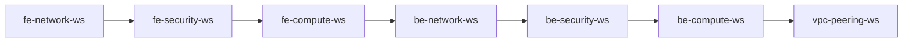

# VPC Peering with Terraform, HCP Terraform, GitHub, OPA, and AWS

A multi-workspace Infrastructure as Code (IaC) project that provisions
frontend and backend AWS environments in separate VPCs, connects them
through VPC peering, and orchestrates workspace runs using HCP
Terraform.

The project combines GitHub-based version control, HCP Terraform
workspaces, policy as code with Open Policy Agent (OPA), and AWS
authentication using OpenID Connect (OIDC) dynamic credentials.

## Architecture

The diagram below shows the end-to-end workflow, including the engineer
workstation, GitHub repository and branches, HCP Terraform organization
and workspaces, OPA policy controls, OIDC authentication, and the AWS
frontend/backend VPC environments.


## Project Objectives

-   Build AWS infrastructure using Terraform.
-   Separate frontend and backend infrastructure into independent HCP
    Terraform workspaces and state files.
-   Establish private connectivity between frontend and backend VPCs
    using VPC peering.
-   Manage configuration changes through GitHub branches and pull
    requests.
-   Use HCP Terraform VCS integration to trigger runs from approved code
    changes.
-   Evaluate Terraform plans using OPA policies.
-   Authenticate HCP Terraform to AWS using OIDC and temporary AWS
    credentials rather than long-lived access keys.
-   Coordinate apply and destroy operations across target workspaces
    using a Workspace Runner.

## Technology Stack

  -----------------------------------------------------------------------
  Area                                Technology
  ----------------------------------- -----------------------------------
  Infrastructure as Code              Terraform

  Workspace and state management      HCP Terraform

  Version control                     Git and GitHub

  Cloud provider                      Amazon Web Services (AWS)

  Cloud authentication                OIDC / AWS STS temporary
                                      credentials

  Policy as Code                      Open Policy Agent (OPA)

  Workspace orchestration             HashiCorp TFE provider
                                      (`tfe_workspace_run`)

  Local execution environment         Ubuntu Linux
  -----------------------------------------------------------------------

## Workspace Architecture

Each target workspace owns its own Terraform state and manages the
resources defined in its configuration. The Workspace Runner manages
orchestration resources; it does not directly own the AWS infrastructure
created by the target workspaces.

  -----------------------------------------------------------------------
  Workspace                           Responsibility
  ----------------------------------- -----------------------------------
  `fe-network-ws`                     Frontend VPC networking resources

  `fe-security-ws`                    Frontend security groups and
                                      security rules

  `fe-compute-ws`                     Frontend EC2 compute resources

  `be-network-ws`                     Backend VPC networking resources

  `be-security-ws`                    Backend security groups and
                                      security rules

  `be-compute-ws`                     Backend EC2 compute resources

  `vpc-peering-ws`                    VPC peering connection and
                                      associated routing configuration

  `workspace-runner-ws`               Orchestrates runs in the seven
                                      target workspaces
  -----------------------------------------------------------------------

## Workspace Execution Sequence

The Workspace Runner uses Terraform dependency relationships
(`depends_on`) to enforce the intended execution order.

### Apply sequence



The sequence creates network foundations first, followed by security and
compute resources, and finally VPC peering and its routes.

### Destroy sequence

Destroy follows the reverse dependency order:

``` mermaid
flowchart RL
    A["fe-network-ws"] <-- B["fe-security-ws"]
    B <-- C["fe-compute-ws"]
    C <-- D["be-network-ws"]
    D <-- E["be-security-ws"]
    E <-- F["be-compute-ws"]
    F <-- G["vpc-peering-ws"]
```

Read the destroy sequence from right to left:

1.  `vpc-peering-ws`
2.  `be-compute-ws`
3.  `be-security-ws`
4.  `be-network-ws`
5.  `fe-compute-ws`
6.  `fe-security-ws`
7.  `fe-network-ws`

## GitHub Workflow

The repository uses feature branches for workspace changes and a
protected `main` branch as the integration branch.

Typical workflow:

1.  Create or switch to the feature branch associated with the
    workspace.
2.  Make and review Terraform configuration changes.
3.  Commit and push changes to GitHub.
4.  Open a pull request targeting `main`.
5.  Complete the required review and status checks.
6.  Merge the approved pull request.
7.  HCP Terraform detects the VCS change and starts a run for the
    connected workspace, subject to its VCS branch and working-directory
    configuration.

Example branch names:

``` text
fe-network-ws
fe-security-ws
fe-compute-ws
be-network-ws
be-security-ws
be-compute-ws
vpc-peering
workspace-runner
```

Use the actual branch names and working directories configured in the
repository. A Git branch name and an HCP Terraform workspace name do not
have to be identical, but the VCS configuration must point to the
intended source.

## HCP Terraform and OPA Policies

OPA policies evaluate Terraform plan data and enforce infrastructure
requirements. The lab includes these policy examples:

-   **Instance type policy:** restricts EC2 instance types to `t3.micro`
    (mandatory enforcement).
-   **Public ingress policy:** checks for broad public ingress such as
    `0.0.0.0/0` (advisory enforcement in this lab).

A mandatory policy failure blocks the run from proceeding to apply. An
advisory policy can report a violation without necessarily blocking
apply. The actual result depends on the policy set's enforcement level
and HCP Terraform run settings.

## AWS Authentication with OIDC

HCP Terraform uses OIDC to obtain temporary AWS credentials for
Terraform runs.

High-level flow:

1.  HCP Terraform requests an OIDC identity token for the run.
2.  AWS STS validates the token through the configured AWS IAM OIDC
    identity provider.
3.  The IAM role trust policy determines whether the organization,
    project, workspace, and run phase are allowed to assume the role.
4.  AWS STS returns temporary credentials.
5.  The Terraform AWS provider uses those credentials to call AWS APIs.
6.  The permissions policy attached to the assumed IAM role determines
    which AWS actions are authorized.

The lab uses separate plan and apply roles:

-   `aws-plan-role` for plan operations.
-   `aws-apply-role` for apply operations.

Configure the following as HCP Terraform workspace environment
variables, using the actual role ARNs from your AWS account:

``` text
TFC_AWS_PROVIDER_AUTH=true
TFC_AWS_PLAN_ROLE_ARN=<AWS plan role ARN>
TFC_AWS_APPLY_ROLE_ARN=<AWS apply role ARN>
```

Do not commit credentials, API tokens, or secrets to GitHub. For
production, replace broad permissions such as `AdministratorAccess` with
least-privilege IAM policies.

## Workspace Runner: CLI-Driven Local Execution

In this lab, `workspace-runner-ws` uses CLI-driven local execution from
an Ubuntu workstation. The runner uses the HashiCorp TFE provider to
communicate with the HCP Terraform API and queue runs in the target
workspaces.

This approach was selected after encountering run-queue/concurrency
constraints while the runner itself was executing remotely on the HCP
Terraform Free plan.


