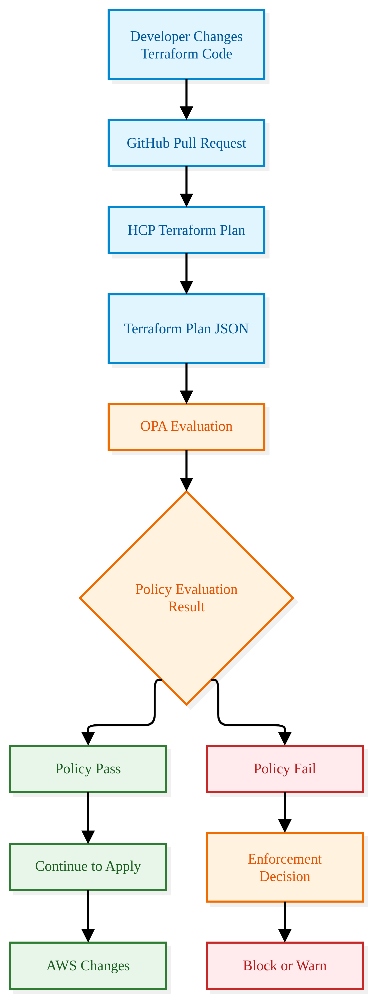
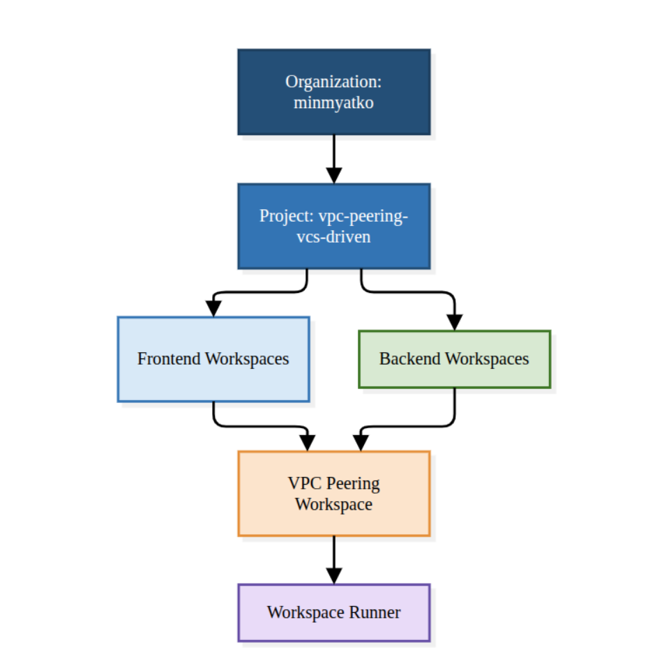

# AWS VPC Peering – VCS-Driven Terraform Project
## Study Notes: HCP Terraform, OIDC, AWS IAM Roles, OPA Policies and Workspace Runner

---

# 1. Project Summary

### Project objective

Build and manage an AWS VPC Peering infrastructure using **GitHub, HCP Terraform VCS-driven workspaces, AWS Dynamic Credentials, and OPA policy enforcement**.

The project separates infrastructure into multiple workspaces to improve modularity, security, collaboration, and management.

### Architecture

The project contains two VPCs:

| Component | Frontend | Backend |
|---|---|---|
| VPC CIDR | 10.0.0.0/16 | 192.168.0.0/16 |
| Network workspace | fe-network-ws | be-network-ws |
| Security workspace | fe-security-ws | be-security-ws |
| Compute workspace | fe-compute-ws | be-compute-ws |

Additional workspace:
- `vpc-peering-intra-region-ws`: Connects frontend and backend VPCs.
- `workspace-runner-ws`: Coordinates the execution and destruction of multiple workspaces.

### Main technologies

- **GitHub:** Source code management and pull request reviews.
- **HCP Terraform:** Remote Terraform execution and workspace management.
- **AWS OIDC:** Identity federation between HCP Terraform and AWS.
- **AWS IAM Roles:** Grant temporary AWS permissions.
- **OPA:** Policy enforcement using Rego.
- **Terraform:** Infrastructure as Code.
- **VPC Peering:** Private communication between frontend and backend VPCs.

### Overall workflow


---

# 2. OIDC and AWS IAM Roles (AWS Dynamic Credentials)

## 2.1 What is OIDC?

**OIDC (OpenID Connect)** is an identity authentication protocol built on OAuth 2.0.

It allows one system to verify the identity of another system without sharing long-term credentials such as AWS access keys.

In this project:

- HCP Terraform acts as the identity provider (OIDC issuer).
- AWS IAM trusts the HCP Terraform OIDC identity provider.
- HCP Terraform obtains temporary AWS credentials through AWS STS.

### Why use OIDC?

Traditional authentication:


Problems:
- Long-term credentials must be stored.
- Keys can be exposed accidentally.
- Keys require rotation.
- Credentials may have excessive permissions.

OIDC authentication:


Benefits:
- No long-term AWS access keys required.
- Temporary credentials.
- Identity-based authentication.
- Better security and access control.

## 2.2 How does OIDC work?

OIDC uses an identity token, usually a JWT (JSON Web Token), to prove the identity of a workload.

A simplified workflow:

1. HCP Terraform starts a Terraform run.
2. HCP Terraform obtains an OIDC identity token for the run.
3. Terraform's AWS provider uses that token to request AWS credentials.
4. AWS STS receives the token through `AssumeRoleWithWebIdentity`.
5. AWS validates the token against its configured OIDC identity provider.
6. AWS checks the IAM role's trust policy.
7. If the identity and trust conditions match, AWS issues temporary credentials.
8. Terraform uses those credentials to manage AWS resources.

## 2.3 What is an AWS IAM Role?

An IAM Role is an AWS identity that has a set of permissions.

Unlike an IAM user, a role does not have permanent access keys.

A trusted identity assumes the role and receives temporary credentials.

An IAM role has two important components:

**A. Trust policy**

Defines WHO can assume the role.

In this project, the trust policy allows the correct HCP Terraform OIDC identity to assume the role.

It checks conditions such as:
- OIDC issuer.
- Audience (`aud`).
- Subject (`sub`), which can restrict access to a specific organization, project, workspace, and run phase.

**B. Permissions policy**

Defines WHAT the role can do.

Examples:
- Create VPCs.
- Create subnets.
- Create route tables.
- Create security groups.
- Create EC2 instances.
- Create VPC peering connections.

| IAM component | Main question |
|---|---|
| Trust policy | Who can assume this role? |
| Permissions policy | What can this role do? |

## 2.4 How OIDC and AWS IAM Roles work together

In this project, uses two separate AWS IAM roles:

| IAM Role | Purpose |
|---|---|
| `aws-plan-role` | Read-only permissions for Terraform plan |
| `aws-apply-role` | Permissions to create, modify, and delete AWS resources during apply |

### Authentication workflow


### HCP Terraform workspace variables

For AWS dynamic credentials, configure these environment variables:

| Variable | Value |
|---|---|
| `TFC_AWS_PROVIDER_AUTH` | `true` |
| `TFC_AWS_PLAN_ROLE_ARN` | ARN of `aws-plan-role` |
| `TFC_AWS_APPLY_ROLE_ARN` | ARN of `aws-apply-role` |

These settings allow the AWS provider to use dynamic credentials during Terraform runs.

**Important:** Every target workspace that manages AWS resources needs the appropriate AWS authentication configuration. 
*The Workspace Runner itself does not need an AWS provider if it only manages HCP Terraform runs.*

---

# 3. Individual Policies

## 3.1 What are Individual Policies?

An Individual Policy is a policy definition created and managed separately in HCP Terraform.

In this project, created two individual OPA policies:

| Policy | Purpose | Enforcement |
|---|---|---|
| `instance_type` | Restrict EC2 instance types to `t3.micro` | Mandatory |
| `public_ingress` | Detect unrestricted public IPv4 ingress | Advisory |

## 3.2 How do Individual Policies work?

The workflow:

1. Create an individual policy in HCP Terraform.
2. Select the policy framework (OPA).
3. Define a query.
4. Write the policy code using Rego.
5. Select the enforcement level.
6. Attach the policy to a policy set.
7. Target the appropriate project or workspace.

An individual policy defines the rule. A policy set determines where that rule is enforced.

### Example: Instance type policy

Objective: Only allow EC2 instances of type `t3.micro`.

```rego
package terraform.policies.instance_type

import input.plan as plan

deny[msg] {
  r := plan.resource_changes[_]
  r.type == "aws_instance"
  r.change.after != null
  r.change.after.instance_type != "t3.micro"

  msg := sprintf(
    "%v must use instance type t3.micro",
    [r.address]
  )
}
```

Expected results:

| EC2 instance type | Policy result |
|---|---|
| t3.micro | Pass |
| t3.small | Fail |
| t3.medium | Fail |
| t3.large | Fail |

### Mandatory vs Advisory

**Mandatory:**
- Violations prevent the run from proceeding to apply.
- Used for important compliance and security requirements.

**Advisory:**
- Reports policy violations.
- Does not block the apply solely because of the advisory violation.
- Useful for warnings and recommendations.

In Ir project, the instance-type policy is Mandatory, while the public-ingress policy is Advisory.

---

# 4. What is OPA? How do OPA and Policies work?

## 4.1 What is OPA?

**OPA (Open Policy Agent)** is an open-source policy engine used to evaluate policies and make authorization or compliance decisions.


In this project, OPA checks Terraform plans before infrastructure changes are applied.

OPA uses a policy language called **Rego**.

## 4.2 What is Rego?

Rego is the declarative language used to write OPA policies.

For example:

```rego
package terraform.policies.instance_type
```

Defines the policy package.

```rego
import input.plan as plan
```

Accesses the Terraform plan data supplied to the policy.

```rego
r.type == "aws_instance"
```

Checks whether the planned resource is an EC2 instance.

```rego
r.change.after.instance_type != "t3.micro"
```

Checks whether the planned instance type violates the requirement.

## 4.3 How does OPA work with HCP Terraform?



### Example from Ir project

I configured the EC2 instance type as `t3.small`.

Expected result:

```text
Policy violation:
aws_instance must use instance type t3.micro
```

The Mandatory policy blocks the run.

I change the instance type to `t3.micro`, submit another pull request, merge it, and run Terraform again.

Expected result: Policy passes.

## 4.4 Individual Policy vs Policy Set

These two concepts are different.

| Individual Policy | Policy Set |
|---|---|
| Defines a policy rule | Groups and applies policies |
| Contains Rego code | Defines scope and selected policies |
| Defines the policy query | Targets projects and/or workspaces |
| Can be reused | Controls where policies are enforced |

I created a policy set for security-group ingress and selected the individual public-ingress policy.

I also updated the compute policy set to include the instance-type policy.

---

# 5. Organization, Project and Workspace: Different Levels

HCP Terraform organizes infrastructure management into three main levels.

## 5.1 Organization

The Organization is the top-level container.

My organization: 'minmyatko`

It manages:
- Users and teams.
- Projects.
- Workspaces.
- Policies and policy sets.
- Organization-level settings.

Think of an organization as the company or account that owns the Terraform environment.

## 5.2 Project

A Project groups related workspaces.

My project: `vpc-peering-vcs-driven`

Projects help organize workspaces and manage access and governance.

## 5.3 Workspace

A Workspace is where Terraform configuration is executed and its state is managed.

Examples:

- `fe-network-ws`
- `fe-security-ws`
- `fe-compute-ws`
- `be-network-ws`
- `be-security-ws`
- `be-compute-ws`
- `vpc-peering-ws`
- `workspace-runner-ws`

Each infrastructure workspace has its own:
- Terraform configuration and working directory.
- VCS connection and branch settings.
- Terraform state.
- Variables and credentials.
- Runs and execution history.

### Hierarchy



**Note:**

- Organization = Owns and governs the environment.
- Project = Groups related workspaces.
- Workspace = Executes Terraform and maintains state.

---

# 6. What is Workspace Runner? How does it work?

## 6.1 What is Workspace Runner?

Workspace Runner is a Terraform configuration that uses the HCP Terraform provider (`tfe`) to coordinate remote runs across multiple existing HCP Terraform workspaces.

It allows one central workspace to manage the execution order of other workspaces.

In this project:

`workspace-runner-ws`

It coordinates seven target workspaces.

## 6.2 Which provider does Workspace Runner need?

The Workspace Runner uses:

```hcl
terraform {
  required_providers {
    tfe = {
      source  = "hashicorp/tfe"
      version = "~> 0.82.0"
    }
  }
}

provider "tfe" {
  hostname = "app.terraform.io"
}
```

It does not require the AWS provider if it only coordinates HCP Terraform workspace runs.

## 6.3 How does it get workspace IDs?

In my configuratoin,

```hcl
data "tfe_workspace" "target" {
  for_each = var.workspace_names

  organization = var.organization
  name         = each.value
}
```

Explanation:

- `data "tfe_workspace"` looks up an existing workspace.
- `for_each` looks up multiple workspaces.
- `each.value` supplies the actual HCP Terraform workspace name.
- `.id` retrieves the workspace ID.

For example:

```hcl
data.tfe_workspace.target["fe_network"].id
```

Returns the ID of the existing `fe-network-ws`.

The runner then uses this ID:

```hcl
resource "tfe_workspace_run" "fe_network" {
  workspace_id = data.tfe_workspace.target["fe_network"].id
}
```

## 6.4 What is `tfe_workspace_run`?

`tfe_workspace_run` is a resource from the HCP Terraform provider.

It can queue remote apply and destroy runs in another workspace.

Example:

```hcl
resource "tfe_workspace_run" "fe_network" {
  workspace_id = data.tfe_workspace.target["fe_network"].id

  apply {
    manual_confirm = false
    wait_for_run   = true
  }

  destroy {
    manual_confirm = false
    wait_for_run   = true
  }
}
```

Meaning:

| Argument | Meaning |
|---|---|
| `workspace_id` | Target workspace to run |
| `apply` | Queue an apply when this runner resource is created |
| `destroy` | Queue a destroy when this runner resource is destroyed |
| `manual_confirm = false` | Automatically confirm the remote run, subject to other HCP requirements |
| `wait_for_run = true` | Wait for the remote run to finish |

**Important:** Creating a `tfe_workspace_run` resource with an `apply` block queues a new apply. It does not automatically check whether the target workspace has already applied its infrastructure.

If the target workspace already has the correct Terraform state and configuration, its plan should normally show no changes.

## 6.5 How does `depends_on` work?

`depends_on` defines execution dependencies between workspace-run resources.

Example:

```hcl
resource "tfe_workspace_run" "fe_security" {
  workspace_id = data.tfe_workspace.target["fe_security"].id

  depends_on = [
    tfe_workspace_run.fe_network
  ]
}
```

This tells Terraform to wait for the frontend network workspace-run resource before processing the frontend security workspace-run resource.

### The execution sequence in my project


**Apply**
[Apply Sequence in execution](../drawing/apply-sequence.png)
[Destroy Sequence in execution](../drawing/destroy-sequence.png)

The two branches can execute independently. The peering workspace waits for both branches.

This is useful because dependent resources should be removed before the infrastructure they depend on.

# 7. What credentials does Workspace Runner need?

There are two different authentication requirements in this architecture.

## 7.1 HCP Terraform authentication

The runner uses the `tfe` provider to communicate with HCP Terraform.

It needs an HCP Terraform API token.

For example:

```text
TFE_TOKEN
```

The token must have sufficient permissions to access and queue runs in the target workspaces.

I can use a personal user API token or an appropriately authorized team token.

## 7.2 AWS authentication

The runner does not need AWS credentials if it only manages workspace runs.

The target workspaces need AWS authentication because they create and manage AWS infrastructure.

| Workspace | HCP Terraform API access | AWS credentials |
|---|---|---|
| workspace-runner-ws | Yes | No |
| fe-network-ws | Its own VCS/HCP execution context | Yes |
| fe-security-ws | Its own VCS/HCP execution context | Yes |
| fe-compute-ws | Its own VCS/HCP execution context | Yes |
| be-network-ws | Its own VCS/HCP execution context | Yes |
| be-security-ws | Its own VCS/HCP execution context | Yes |
| be-compute-ws | Its own VCS/HCP execution context | Yes |
| vpc-peering-intra-region-ws | Its own VCS/HCP execution context | Yes |


---

# 8. When should I use Workspace Runner?

Workspace Runner is particularly useful when the infrastructure is divided into multiple workspaces with dependencies.

### Example 1: Multi-tier infrastructure

```text
Network → Security → Compute → Application
```

I can coordinate the deployment sequence instead of manually triggering each workspace.

### Example 2: Multi-environment infrastructure

```text
Development
     |
     v
Staging
     |
     v
Production
```

I can coordinate the deployment sequence between environments.

### Example 3: Multi-team infrastructure

```text
Network Team
     |
     v
Security Team
     |
     v
Application Team
```

Each team can manage its own workspace, while a central runner coordinates execution.

### Example 4: Coordinated infrastructure destruction

When several workspaces depend on each other, a runner can help orchestrate the reverse destruction order.

### When I do NOT need Workspace Runner

If I have only one Terraform workspace, or all resources are managed in one configuration, a separate runner is usually unnecessary.

---

# 9. Final Project Summary

This project demonstrates how to build a secure, modular, and automated AWS infrastructure deployment workflow.

GitHub provides version control and collaboration through protected branches and pull requests.

HCP Terraform manages remote Terraform execution through VCS-driven workspaces.

OIDC provides secure authentication between HCP Terraform and AWS without storing long-term AWS access keys.

AWS IAM Roles control what Terraform can do during plan and apply operations.

OPA policies enforce infrastructure rules before changes are applied.

Finally, Workspace Runner coordinates multiple workspaces and their dependencies, making deployment and destruction easier to manage.

**The main lesson:** Infrastructure as Code is not only about creating AWS resources. It is also about managing authentication, authorization, governance, collaboration, execution order, and the complete infrastructure lifecycle.